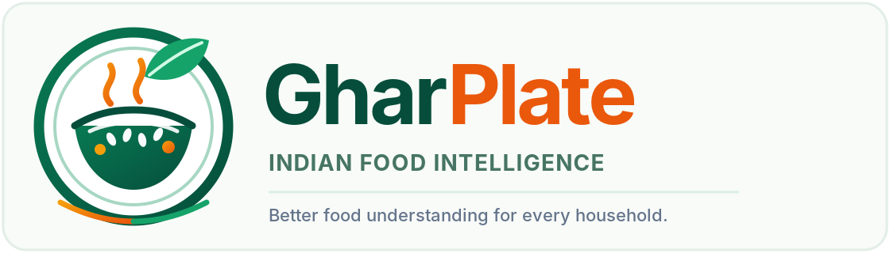

<div align="center">
  
  <h1>GharPlate</h1>
  <p><strong>Indian Household Food Intelligence &amp; Personalised Nutrition</strong></p>
  <p>Understand everyday food with clearer data, transparent sources, and household-aware nutrition context.</p>

  <p>
    <a href="https://github.com/2025csmohammedfaisalpashad-ctrl/GharPlate/actions/workflows/ci.yml?query=branch%3Amain"></a>
    <a href="https://hub.docker.com/r/mrfaisu0243/gharplate-backend"></a>
    <a href="https://hub.docker.com/r/mrfaisu0243/gharplate-frontend"></a>
    <a href="LICENSE"></a>
  </p>
  <p>
    
    
    
    
    
    
  </p>
</div>

---

## 🍽️ About GharPlate

GharPlate is a full-stack, evidence-based food composition, packaged-product intelligence, and condition-aware nutrition-literacy platform designed for Indian households. It helps people explore raw ingredients, regional Indian dishes, recipes, and packaged-food labels in the context of household members' dietary preferences, allergies, intolerances, and health considerations.

The platform combines curated Indian food data with external product-data providers, field-level provenance, deterministic guidance rules, recipe calculations, label scanning, barcode lookup, product comparison, and an optional locally hosted AI assistant.

> [!IMPORTANT]
> **Medical and nutritional safety:** GharPlate is an educational food-information tool. It is **not** a medical diagnostic system or clinical treatment platform, and it is not a substitute for advice from a qualified doctor or registered dietitian. It does not label foods universally “safe”, “unsafe”, “allowed”, or “forbidden”; it does not claim that foods cure or reverse disease; and it does not replace unknown (`NULL`) nutrient values with zero or synthetic estimates. Guidance is contextual, evidence-linked, and subject to data limitations.

## 🧩 Core capabilities

| Area | What GharPlate provides |
|---|---|
| **🇮🇳 Indian food intelligence** | 77+ seeded food records across nine categories: cereals and millets, pulses and legumes, vegetables, fruits, dairy, protein sources, nuts and seeds, Indian dishes, and packaged foods. |
| **🔎 Multilingual food search** | Search in English, Hindi (Devanagari and transliterated), and Kannada (native script and transliterated), with fuzzy matching, category and nutrient filters, and sorting. |
| **🧭 Condition-aware guidance** | A deterministic rules engine covering 24 conditions across nine groups, with 103 explicit condition–food mappings and 43 structured food tags. Guidance is educational, not a diagnosis or treatment recommendation. |
| **👨‍👩‍👧‍👦 Household profiles** | Passwordless household convenience profiles using a browser-held `hh_<uuid>` token. Allergies are modelled separately from digestive intolerances. No mandatory account is required. |
| **🧮 Recipe nutrition calculator** | Calculate recipe nutrition totals and per-serving values using Indian household measures such as katori, cup, bowl, roti, piece, tablespoon, and teaspoon. Nutrient completeness and missing values remain visible. |
| **📷 Packaged-label OCR** | Scan nutrition tables, ingredient/allergen panels, and front-of-pack images. The parser separates ingredients, INS/E-number additives, percentage declarations, allergens, polyols, net quantity, and manufacturer details. OCR output requires review. |
| **📦 Barcode lookup** | Live camera and manual barcode lookup for EAN-8, UPC-A, EAN-13, and GTIN-14. Incomplete local records can be enriched through Open Food Facts while user-confirmed fields are preserved. |
| **🍛 Experimental dish recognition** | Experimental image-assisted identification of Indian dishes. Results should be treated as suggestions for user review, not verified food identification. |
| **⚖️ Product comparison** | Compare two to four packaged products side by side using available label and nutrition data. Missing fields are not silently treated as zero. |
| **🥗 Personalised meal suggestions** | Household-aware meal suggestions that consider profile preferences, allergies, intolerances, and available food data. |
| **🤖 Local GharPlate AI assistant** | A floating “Ask GharPlate” assistant using Ollama, dynamic model discovery, 11 allowlisted backend tools, three search modes, page context, and deterministic tool-backed fallback when the local model is unavailable. |

## 🆕 Recent engineering work

- **Compact home category cards:** all nine homepage category cards use compact, text-first layouts without empty image-preview areas; food photographs remain available on individual food cards.
- **Food imagery:** 84 local WebP assets are included (75 food photographs and nine category images), with attribution metadata in [`docs/IMAGE_ATTRIBUTION.md`](docs/IMAGE_ATTRIBUTION.md).
- **Cross-browser barcode scanning:** native `BarcodeDetector` is complemented by `@zxing/browser` to improve browser compatibility, including Safari camera handling.
- **Resizable AI assistant:** the floating assistant supports resizing, left/right docking, Markdown and GitHub-Flavoured Markdown rendering, and copyable responses/code.
- **Backend quality gates:** Ruff is pinned and configured; the backend CI job performs linting, bytecode compilation, isolated database seeding, and automated tests.
- **Delivery pipeline:** GitHub Actions validates the backend, frontend, Docker images, and Docker Compose smoke test before the gated multi-architecture Docker Hub publish on `main` or version tags.

## 🧱 Technology stack

| Layer | Technologies |
|---|---|
| **Frontend** | React 18, TypeScript, Vite, Tailwind CSS, React Router v6, Vitest, React Testing Library |
| **Backend** | Python 3.12+, FastAPI, Pydantic v2, SQLAlchemy 2.0, Alembic, Pillow, HTTPX |
| **Database** | SQLite by default; SQLAlchemy and migrations provide a path toward PostgreSQL |
| **Food-data providers** | ICMR-NIN IFCT 2017, Dietary Guidelines for Indians 2024, Open Food Facts API v3/v2, USDA FoodData Central (optional API key) |
| **Optional web search** | Configurable Brave Search or Tavily adapter |
| **Local AI** | Ollama; configurable local model and tool-backed backend assistant |
| **OCR and barcode** | Tesseract OCR, Pillow preprocessing, native browser `BarcodeDetector`, `@zxing/browser` |
| **DevOps** | Docker, Docker Compose, Nginx, GitHub Actions, Docker Hub |

## 🗃️ Data sources, provenance, and quality

GharPlate is designed to show where data comes from rather than presenting every field as equally authoritative.

- **Food composition and guidance references:** ICMR-NIN IFCT 2017, Dietary Guidelines for Indians 2024, and relevant public health or clinical guidance documented in the source register.
- **Packaged products:** Open Food Facts and user-reviewed package-label declarations; USDA FoodData Central is an optional supplemental provider.
- **Field-level traceability:** product fields can retain source provenance, confidence information, conflict records, and cached external lookup responses.
- **Unknown data stays unknown:** missing nutrient values remain `NULL`; OCR failures do not invent label values; conflicting provider values are not silently hidden.
- **Demo and seeded data:** seeded records are application data with declared sources and confidence. They should not be interpreted as a complete reproduction of any licensed source dataset.

See [`docs/DATA_SOURCES.md`](docs/DATA_SOURCES.md), [`docs/DATA_PROVENANCE.md`](docs/DATA_PROVENANCE.md), and [`docs/DATA_QUALITY.md`](docs/DATA_QUALITY.md).

## 🗂️ Repository structure

```text
GharPlate/
├── backend/
│   ├── app/
│   │   ├── api/v1/                 # FastAPI routes
│   │   ├── core/                   # Settings and configuration
│   │   ├── db/                     # Schema, seed data, mappings and images
│   │   ├── integrations/           # Open Food Facts, USDA, web search, cache
│   │   ├── models/                 # SQLAlchemy entities
│   │   ├── rules/                  # Deterministic guidance engine
│   │   └── services/               # Food, recipe, OCR, barcode, assistant, meals
│   ├── migrations/                 # Alembic migrations
│   ├── tests/                      # Backend and end-to-end tests
│   ├── requirements.txt
│   └── Dockerfile
├── frontend/
│   ├── public/images/              # Local food and category imagery
│   ├── src/
│   │   ├── components/             # Layout, UI widgets, assistant drawer
│   │   ├── hooks/                  # Household state
│   │   ├── pages/                  # Home, search, profiles, recipes, scanner, etc.
│   │   ├── services/               # API client
│   │   └── utils/                  # Visual assets and helpers
│   ├── tests/
│   ├── package.json
│   └── Dockerfile
├── data/                           # Raw/processed data and import reports
├── docs/                           # Architecture, safety, data, testing and runbooks
├── scripts/                        # Data seeding utilities
├── .github/workflows/              # CI/CD and Docker publishing
├── docker-compose.yml
├── docker-compose.release.yml
├── .env.example
├── LICENSE
└── README.md
```

## 🚀 Quickstart

### Prerequisites

- Python 3.12 or newer
- Node.js 22 LTS and npm
- Git
- Docker Desktop (for the containerised setup)
- Ollama (optional, for the local AI assistant)
- Tesseract OCR installed on the host if running OCR locally outside Docker

### 1. Run the backend API

```bash
cd backend
python3 -m venv .venv
source .venv/bin/activate
pip install -r requirements.txt
PYTHONPATH=. python -m uvicorn app.main:app --reload --host 0.0.0.0 --port 8000
```

- API health: <http://localhost:8000/api/v1/health>
- Swagger / OpenAPI: <http://localhost:8000/docs>

### 2. Run the React frontend

Open a second terminal from the repository root:

```bash
cd frontend
npm ci
npm run dev
```

Open <http://localhost:5173>. The frontend API client defaults to `/api/v1`; use the Vite proxy configured in `frontend/vite.config.ts` for local development.

### 3. Optional: run the local Ollama assistant

```bash
ollama serve
ollama pull qwen2.5vl:7b
```

Set `OLLAMA_MODEL` to the model installed on your machine if you want to select it as the default. The assistant can use the backend's deterministic database tools when a local model is unavailable; model-dependent answers require Ollama to be running and reachable.

### 4. Run with Docker Compose

From the repository root:

```bash
cp .env.example .env
docker compose up --build -d
```

Open <http://localhost:8080>. The API is exposed on port `8000`. Docker Compose stores the SQLite database in the named `gharplate_sqlite_data` volume. To use host Ollama from a container, set `OLLAMA_BASE_URL=http://host.docker.internal:11434` in the root `.env` file.

### 5. Run the published Docker Hub images

```bash
docker pull mrfaisu0243/gharplate-backend:latest
docker pull mrfaisu0243/gharplate-frontend:latest
docker compose -f docker-compose.release.yml up -d
```

Open <http://localhost:8080>. The release Compose file creates its own persistent volume, `gharplate_release_data`.

## 🧪 Quality checks

Run the same core checks used by the repository's CI workflow.

**Backend**

```bash
cd backend
ruff check app tests
python -m compileall -q app tests
PYTHONPATH=. pytest -v tests/
```

**Frontend**

```bash
cd frontend
npm ci
npm run lint
npm test
npm run build
```

**CI pipeline overview**

| Stage | Automated checks |
|---|---|
| 1. Backend | Ruff lint, Python compilation, isolated database seed validation, Pytest |
| 2. Frontend | TypeScript lint, Vitest, production Vite build |
| 3. Container build | Backend and frontend Docker image build validation |
| 4. Full-stack smoke test | Docker Compose startup, API health, category/search endpoints, frontend availability |
| 5. Docker Hub release | Gated multi-architecture image publishing on `main` and version tags |
| Summary | A GitHub Actions job records the outcome of the validation stages |

The live **CI badge at the top** tracks the latest `ci.yml` run on `main`. A green badge means that workflow run passed; check the individual commit's Checks tab for the status of a specific commit.

## 🎨 Design and frontend implementation

The interactive application frontend is implemented in **React + TypeScript**. Figma is used for design capture, visual presentation, and prototyping. The Figma file does not replace the React runtime or automatically generate the application's working frontend. Any Code Connect mappings should be described as published only after they have actually been configured and verified.

## 🔐 Privacy and security notes

- No mandatory login is required. A random household token is generated in the browser and stored in `localStorage` under `gharplate_household_token`.
- Treat the household token as private: anyone who obtains it may be able to access that household's data. Do not enter real sensitive health information into a public demonstration.
- Uploaded label images are processed for extraction and should not be treated as a permanent document store.
- Optional API keys belong in a local `.env` file and must never be committed. Start from `.env.example` and keep `.env` out of Git.
- Review OCR output, allergen extraction, source provenance, and confidence labels before relying on the information.

Read [`docs/PRIVACY.md`](docs/PRIVACY.md), [`docs/SECURITY.md`](docs/SECURITY.md), and [`docs/MEDICAL_SAFETY.md`](docs/MEDICAL_SAFETY.md).

## 📚 Documentation

- [Architecture](docs/ARCHITECTURE.md)
- [API contract](docs/API_CONTRACT.md)
- [Data sources](docs/DATA_SOURCES.md)
- [Data provenance](docs/DATA_PROVENANCE.md)
- [Data quality](docs/DATA_QUALITY.md)
- [Product data integration](docs/PRODUCT_DATA_INTEGRATION.md)
- [Barcode lookup](docs/BARCODE_LOOKUP.md)
- [OCR and ingredient extraction](docs/OCR_AND_INGREDIENT_EXTRACTION.md)
- [Condition-aware recommendation logic](docs/CONDITION_FOOD_RECOMMENDATION_LOGIC.md)
- [Ollama assistant](docs/OLLAMA_ASSISTANT.md)
- [Testing](docs/TESTING.md)
- [CI/CD runbook](docs/CI_CD_RUNBOOK.md)
- [Docker guide](docs/DOCKER_GUIDE.md)
- [Deployment](docs/DEPLOYMENT.md)
- [Figma integration notes](docs/FIGMA_INTEGRATION.md)
- [Image attribution](docs/IMAGE_ATTRIBUTION.md)
- [Project status](docs/PROJECT_STATUS.md)

## 👥 Team project

GharPlate is a five-person Collaborative Development and DevOps (CDD) mini-project at **The National Institute of Engineering (NIE), Mysuru**. See the project documentation and team workflow for implementation responsibilities and collaboration guidance.

## 📄 License

This project is distributed under the [MIT License](LICENSE).
